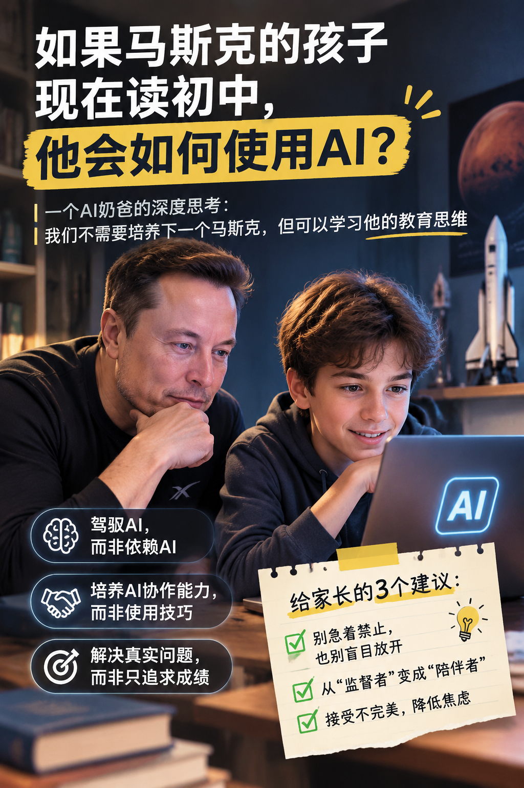

## 写在前面

昨晚陪孩子写作业，我脑子里突然冒出一个念头：

**如果马斯克的孩子现在读初中，面对AI，他会怎么引导孩子？**

先说明一下，这不是蹭热点。这是一个普通家长很真实的焦虑，我自己就在反复琢磨这几个问题：

- 别人家的孩子都在用AI，我们不用，会不会落后？
- 孩子用了AI，会不会慢慢失去独立思考的能力？
- 到底该怎么让孩子用AI，才算用对了？

带着这些问题，我读了不少马斯克谈教育的公开言论，也了解了他2014年前后为孩子办的那所小学校（Ad Astra，后来发展成 Astra Nova）。

需要说清楚的是：**下面写的，是我从他的思维方式里借来的启发，以及我自己的想象和实践，并不是他本人的"育儿指南"。** 但这些启发，确实让我豁然开朗了不少。

今天想和你聊聊。

---

## 一、我想让孩子"驾驭"AI，而不是"依赖"AI

### 我以前犯的错

坦白讲，我之前对AI的态度，大概是这样的：

- "AI会做数学题，那就让它帮孩子检查作业吧。"
- "AI能写作文，让孩子参考一下，分数不就上去了？"
- "这么方便的工具，用了效率肯定更高。"

结果呢？我发现孩子遇到难题，第一反应不再是皱眉思考，而是打开对话框：**"问AI。"**

那一刻我才意识到，问题不在孩子，在我给他立的"规矩"。

### 换一个角度想

马斯克常讲"第一性原理"：回到问题最本质的地方去思考。套到AI上，我给自己换了一个问法：

- 不是问："AI能帮我解决什么？"
- 而是问："**我想解决什么，AI可以怎么配合我？**"

放到孩子的日常里，大概是这样：

**场景一：数学题不会做**

- ❌ 直接让AI给答案
- ✅ 自己先试，卡住了再问："我这个思路，问题出在哪？"

**场景二：作文没思路**

- ❌ 让AI生成一篇范文"参考"
- ✅ 先自己列提纲，再问AI："我这个结构合理吗？可以怎么调整？"

**场景三：单词记不住**

- ❌ 只让AI翻译，记个中文意思
- ✅ 让AI编几个贴近生活的场景例句，在语境里理解、记忆

三个场景看下来，我的体会是：关键从来不在"用不用AI"，而在于——**谁是主导者。**

---

## 二、比"会用AI"更重要的，是"会和AI协作"

### 一次让我很生气的经历

上个月，我让孩子用AI写《骆驼祥子》的读后感。

他是怎么做的？输入一句"帮我写一篇《骆驼祥子》的读后感"，然后复制、粘贴，交差。

我当时火气一下就上来了。但冷静下来想想：**这真不能怪他。** 我只告诉过他"AI可以用"，却从来没教过他"AI该怎么用"。

### 我和孩子一起拆了这件事

后来我们坐下来，把"写读后感"这件事重新拆了一遍。

**第一步：先问目的。**
我问他："你写这篇读后感，是为了什么？"

- 只是应付老师？那AI生成就够了，只是这样做没什么意义。
- 想真正理解祥子的悲剧？那就得自己去想。

**第二步：拆解任务。**
写读后感其实包括四件事：

1. 梳理故事情节
2. 找出最触动自己的地方
3. 分析人物的命运
4. 联系现实，谈自己的思考

**第三步：按需分工。**

- 第1步，让AI帮忙梳理时间线（它擅长整理）
- 第2步，必须自己想（这是整篇文章的核心）
- 第3步，把自己的观点说给AI听，让它当"陪练"，提出不同角度
- 第4步，自己动笔写（表达，是属于他自己的能力）

### 两种用法的差别

| 用法       | 短期             | 长期               |
| ---------- | ---------------- | ------------------ |
| 直接让AI写 | 作业很快完成     | 思考能力得不到锻炼 |
| 和AI协作   | 可能要多花些时间 | 思考和表达都在进步 |

对一个正在读初中的孩子来说，我宁愿他慢一点，也不想他快而空。

---

## 三、比"成绩"更值得关注的，是"解决问题的能力"

### 一个让我印象很深的做法

据公开报道，马斯克办的那所学校，不太按传统方式分年级，也不强调考试和分数，而是更多地围绕真实的问题展开学习，比如"如果一个湖被污染了，我们该怎么办？"。

孩子们要自己去查资料、想办法、分工合作，而工具，只是帮他们把事情做成的手段。

这给了我很大的启发：**这种思路，普通家庭也能做。**

### 我和孩子的一次"AI项目式学习"

**问题：** 孩子英语口语不太好，不敢开口。

**以前我会怎么做？** 报班、下载跟读App、逼他每天背单词。效果呢？他越来越抗拒。

**这次我们换了个方式，给自己定了一个目标：**

🎯 **30天后，能用英语介绍自己的兴趣爱好。**

然后把任务拆成四周：

- **第1周：** 让AI根据他的兴趣，生成一份专属话题词汇表
- **第2周：** 每天和AI聊5分钟，让AI扮演一位外国朋友
- **第3周：** 让AI来提问，他来回答，难度一点点往上加
- **第4周：** 录一段视频，让AI点评发音和语法

在这个过程里，AI的角色是**词汇教练、对话陪练和即时反馈的老师**；而孩子的角色，是**设定目标的人、每天坚持练习的人，以及反思"哪里还不够好"的人。**

30天后，变化是真实的：

- 从不敢开口，到主动找AI练习
- 从死记单词，到在场景里用单词
- 从应付任务，到"我真的想说得更好"

我觉得，这才是AI最值得被用的地方：**帮孩子解决一个他自己在意的真问题，而不只是帮他拿分数。**

---

## 四、给同样焦虑的家长，我的三点体会

### 1. 别急着禁止，也别盲目放开

身边我见过两种极端：

- ❌ "AI会让孩子变笨，绝对不能碰！"
- ❌ "AI这么厉害，让他随便用吧！"

我现在的做法是：**先观察，再引导。**

1. 和孩子一起用一次AI，不说教，就当一起探索
2. 问问他："你觉得这个工具哪里好用？哪里不靠谱？"
3. 一起聊："什么时候该用AI？什么时候不该用？"

### 2. 从"监督者"变成"陪伴者"

以前我的口头禅是：

- "作业写完了吗？"
- "怎么又在玩手机？"
- "别用AI，自己想！"

现在我常说的是：

- "今天遇到什么有意思的问题了？"
- "我们一起看看AI怎么说？"
- "它说的对吗？你怎么看？"

神奇的是，孩子开始愿意主动跟我分享他学了什么，而不再是应付我。

有句话我特别喜欢："教育不是灌满一桶水，而是点燃一把火。"（这句话常被误传为马斯克所说，其实通常认为出自叶芝，或是对普鲁塔克思想的转述。）在AI时代，我想做的就是后者：少一些管控，多一点点燃。

### 3. 接受不完美，给自己松绑

说句扎心的实话：我们这代家长，本身就是在应试教育里长大的。我们自己都没经历过"AI时代的学习"，凭什么要求孩子一上来就用对？

所以我给自己定了几条规矩：

- 孩子用错了？没关系，一起聊聊为什么错。
- 孩子有点依赖AI？没关系，一步一步引导。
- 成绩暂时没起色？没关系，先看过程。

我想培养的，不是一个"完美的孩子"，而是一个**会思考、能适应变化的孩子。**

---

## 五、最后想说的话

写这篇文章的时候，我一直在问自己：

**"我真的需要让孩子成为下一个马斯克吗？"**

答案是：**不需要。**

但我可以借鉴那种思维方式：

- 培养孩子**驾驭工具**，而不是依赖工具
- 引导孩子**解决真实问题**，而不是追求标准答案
- 做孩子的**陪伴者**，而不是监督者

AI时代，我们都是新手家长。别怕犯错，别怕慢，也别怕不完美。

陪着孩子一起探索，一起成长，这大概就是我们能给他最好的礼物。

---

## 聊聊你的想法

在孩子使用AI这件事上，你最大的焦虑是什么？欢迎在评论区告诉我，也许下一篇文章，我们就一起来聊聊它。
